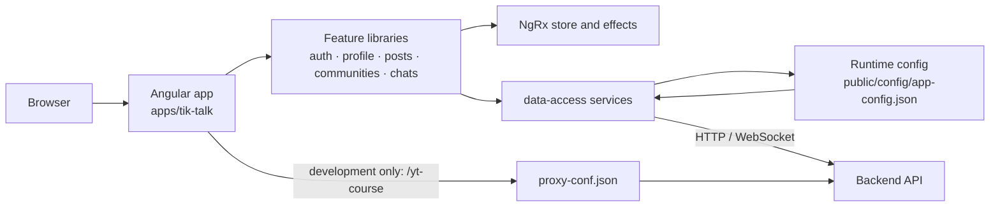

# TikTalk

TikTalk is an Angular single-page social application for authenticated profiles, posts, communities, and direct messaging.

## Overview

This repository contains the TikTalk web client. It is an Nx workspace built with Angular standalone components and SCSS. The application communicates with a separately hosted backend; the backend implementation and its deployment are not part of this repository.

TikTalk is intended for users who want to discover profiles and communities, publish and discuss posts, and exchange direct messages. Developers can use the workspace to extend the UI, feature libraries, state management, and API integrations.

## Quick start

```bash
git clone <repository-url>
cd tik-talk
yarn install --frozen-lockfile
yarn start
```

Open `http://localhost:4200`. The development server proxies the configured `/yt-course` API prefix to `https://icherniakov.ru` by default. See [Configuration](#configuration) before using a different backend.

## Features

- Username/password sign-in with access and refresh tokens stored in browser cookies.
- Protected profile pages, profile search, subscriber previews, profile editing, and avatar upload.
- Address suggestions through the DaData address-suggestion API when a token is configured in the source.
- Personal and community post feeds, post creation, and comments.
- Community browsing, filtering, creation, subscriber previews, and join/leave actions.
- One-to-one chat creation, chat search, unread-count updates, and WebSocket message delivery.
- An NgRx-based client state layer for profiles, posts, and communities.
- Developer-facing experimental routes for Angular forms, RxJS, routing, and dynamic-content examples.

## Architecture

The `tik-talk` application bootstraps Angular and loads `config/app-config.json` before rendering. Feature libraries supply routed views and reusable UI; `data-access` contains API services, typed models, and NgRx effects. Requests use the configured API base URL. In development, requests under `/yt-course` are forwarded by the Angular dev-server proxy. Chats also connect to the backend WebSocket endpoint.



### Application routes

All routes except `/login` and the experimental routes are protected by the authentication guard.

| Route              | Purpose                                                                        |
| ------------------ | ------------------------------------------------------------------------------ |
| `/login`           | Sign in.                                                                       |
| `/profile/me`      | Current user profile and post feed; this is the default authenticated route.   |
| `/profile/:id`     | Another user’s profile.                                                        |
| `/settings`        | Edit the current profile and upload an avatar.                                 |
| `/search`          | Search profiles by first name, last name, and skills.                          |
| `/communities`     | Browse, filter, and create communities.                                        |
| `/communities/:id` | View a community, its posts, and membership controls.                          |
| `/chats/:id`       | Open an existing chat; `/chats/new?userId=<id>` creates a chat from a profile. |
| `/news`            | Submit and display a local topic value; it does not fetch news.                |

`/experimental`, `/experimental2`, `/experimental3`, `/experimental4`, and `/dynamic` are implementation experiments rather than end-user product flows.

## Requirements

- Node.js `24.19.0`, as pinned in [.nvmrc](.nvmrc).
- Yarn Classic (Yarn 1); the checked-in lockfile resolves with Yarn `1.22.22` in this workspace.
- A compatible TikTalk backend for authenticated application workflows. The repository only provides the frontend.

The project is a browser application and has no database, Docker image, or local backend service in this repository. The GitLab CI configuration currently uses Node `20.11-alpine`, which differs from the local Node version pinned by `.nvmrc`.

## Installation

1. Install the Node version declared in [.nvmrc](.nvmrc). With nvm:

   ```bash
   nvm install
   nvm use
   ```

2. Install the locked dependencies:

   ```bash
   yarn install --frozen-lockfile
   ```

3. Review [Configuration](#configuration), then start the development server:

   ```bash
   yarn start
   ```

## Configuration

There is no `.env` file or environment-variable loader. Runtime configuration is fetched at application startup from [public/config/app-config.json](public/config/app-config.json). The file is copied into every build as `config/app-config.json`.

| Setting  | Required | Purpose                                                                       | Current value / format                                             |
| -------- | -------- | ----------------------------------------------------------------------------- | ------------------------------------------------------------------ |
| `apiUrl` | Yes      | Prefix prepended to all application API requests and the chat WebSocket path. | A string URL or path prefix. The checked-in value is `/yt-course`. |

For local development, [proxy-conf.json](proxy-conf.json) forwards `/yt-course` and `/yt-course/chat/ws` to `https://icherniakov.ru`; the chat proxy enables WebSocket forwarding. If `apiUrl` changes, update the proxy rules as needed. The proxy is used only by `yarn start`; a deployed static build must arrange routing for its API prefix outside this repository.

### Optional DaData address suggestions

The profile settings address control calls DaData directly. Its token is a source constant, not a runtime setting or environment variable:

| Setting                                                                                     | Required                                                                        | Purpose                                           | Current value |
| ------------------------------------------------------------------------------------------- | ------------------------------------------------------------------------------- | ------------------------------------------------- | ------------- |
| `DADATA_TOKEN` in [dadata.token.ts](libs/data-access/src/lib/common-ui/api/dadata.token.ts) | Optional for the rest of the app; required for authenticated DaData suggestions | Sent as `Authorization: Token <token>` to DaData. | Empty string  |

Do not commit a real token. Use an appropriate secret-management or build-time injection approach for deployments; none is implemented in this repository.

## Usage

Start the client in development mode:

```bash
yarn start
```

Sign in at `http://localhost:4200/login`. On success, the client stores `token` and `refreshToken` cookies and redirects to `/profile/me`. Requests receive a Bearer token; a `403` response triggers a refresh request. If refresh fails, the client clears its cookies and returns to `/login`.

Common authenticated workflows:

- Open **Search** to filter profiles; select a profile and use its message action to create or open a chat.
- Open **Communities** to filter the list, create a community, or join and leave an existing community.
- Open **Settings** to edit profile fields, skills, city/address, and avatar. Saving dispatches profile-update and optional avatar-upload requests.
- On a profile or a community owned by the current user, create a post; open a post’s comments to read or add comments.

## Development

The root package scripts are:

| Command             | What it does                                                                                                             |
| ------------------- | ------------------------------------------------------------------------------------------------------------------------ |
| `yarn start`        | Serves `tik-talk` using the development build and [proxy-conf.json](proxy-conf.json).                                    |
| `yarn build`        | Produces the default production build in `dist/apps/tik-talk`.                                                           |
| `yarn watch`        | Rebuilds with the development configuration when files change.                                                           |
| `yarn test`         | Existing script that invokes Nx without a project argument and therefore fails; use the explicit project commands below. |
| `yarn ng <command>` | Runs an Angular CLI command through the local dependency.                                                                |

Nx workspace commands provide the quality workflows that are not exposed as root scripts:

```bash
# Lint every project that defines a lint target.
yarn nx run-many -t lint

# Check formatting without changing files.
yarn prettier --check .

# Format repository files in place.
yarn prettier --write .

# Build the production application explicitly.
yarn nx build tik-talk --configuration=production

# Build a source-map-enabled development bundle.
yarn nx build tik-talk --configuration=development
```

ESLint uses the root [eslint.config.mjs](eslint.config.mjs) plus library-level Angular configurations. Prettier settings live in [.prettierrc](.prettierrc), and TypeScript is configured for strict checking in [tsconfig.base.json](tsconfig.base.json). There is no standalone type-check target or root lint/format script.

## Testing

Libraries use Jest through Nx; the application retains its separate Angular `@angular/build:unit-test` target. The focused suite covers authentication/session HTTP contracts, NgRx cancellation/concurrency and a real login/profile/post workflow using Angular TestBed and jsdom. See [testing documentation](docs/testing.md) for scenarios, evidence and remaining gaps.

Run the focused suite without cached or empty success:

```bash
yarn nx run-many -t test --projects=auth,data-access,profile --runInBand --skip-nx-cache --passWithNoTests=false
```

Run one library target, for example:

```bash
yarn nx test auth
```

The Jest targets accept the inherited `ci` configuration, which enables coverage and writes it under `coverage/<project-root>`:

```bash
yarn nx test auth --configuration=ci
```

The workflow tests are router/HTTP/component/store integration tests, not browser E2E. No browser runner is configured, and CI does not yet run the suite. On Windows, use `yarn.cmd` if PowerShell blocks `yarn.ps1`.

## Build and deployment

`yarn build` creates an optimized, hashed production bundle under `dist/apps/tik-talk`. The production build enforces a 500 kB initial-bundle warning threshold and 1 MB error threshold, plus per-component-style thresholds defined in [apps/tik-talk/project.json](apps/tik-talk/project.json).

[.gitlab-ci.yml](.gitlab-ci.yml) defines dependency-install, lint, build, and manual deployment stages for `main` and merge requests. The build stage publishes `dist` as an artifact. The two manual deployment jobs SSH to an externally managed `deploy-tik-talk/deploy.sh`; that script, host configuration, and destination infrastructure are not included here, so the full deployment procedure cannot be reproduced from this repository alone.

The CI lint job calls `yarn lint`, but `package.json` does not define that script. The repository-supported equivalent is:

```bash
yarn nx run-many -t lint
```

## Project structure

```text
apps/
  tik-talk/                 # Angular application bootstrap, routes, global styles, build targets
libs/
  auth/                     # Login UI, auth guard, and HTTP interceptor exports
  chats/                    # Chat list, workspace, and messaging UI
  common-ui/                # Shared controls, pipes, modals, portals, and directives
  communities/              # Community browsing, creation, detail, and UI features
  data-access/              # API clients, domain interfaces, NgRx state, and WebSocket adapter
  experimental/             # Isolated Angular and RxJS experiments
  layout/                   # Authenticated shell and sidebar
  news/                     # Local topic-form route
  posts/                    # Post feed, post input, and comment UI
  profile/                  # Profile display, settings, search, and profile UI
  shared/                   # Runtime configuration and shared utilities
public/
  config/app-config.json    # Runtime API base-path configuration
  assets/                   # Images, SVG icons, and fonts copied to the build
proxy-conf.json             # Development API and WebSocket proxy
```

## Security

- Do not place credentials, refresh tokens, DaData tokens, or private keys in source control.
- The client stores authentication tokens in cookies named `token` and `refreshToken`, and sends the access token in an `Authorization: Bearer` header. Cookie flags such as `Secure`, `HttpOnly`, and `SameSite` are not set by this client implementation; assess this before production use.
- GitLab deployment jobs expect the protected CI variables `DEPLOY_PRIVATE_KEY` (base64-encoded private key), `DEPLOY_KNOWN_HOSTS`, `DEPLOY_USER_HOST`, and `DEPLOY_HOST_COPY`. Configure them in GitLab rather than in the repository.
- The app config is a public static asset. It must contain only a non-secret API URL or path prefix.

## Contributing

No repository-specific contribution guide is present. To contribute:

1. Create a branch and make a focused change.
2. Run `yarn nx run-many -t lint`, `yarn prettier --check .`, and the relevant `yarn nx test <project>` commands.
3. Run `yarn build` when changing application code or build configuration.
4. Open a merge request with a clear summary and validation results.

## License

This repository does not currently specify a license.

## Additional documentation

- [Nx workspace configuration](nx.json)
- [Application build and serve targets](apps/tik-talk/project.json)
- [Runtime API configuration](public/config/app-config.json)
- [GitLab CI/CD pipeline](.gitlab-ci.yml)
